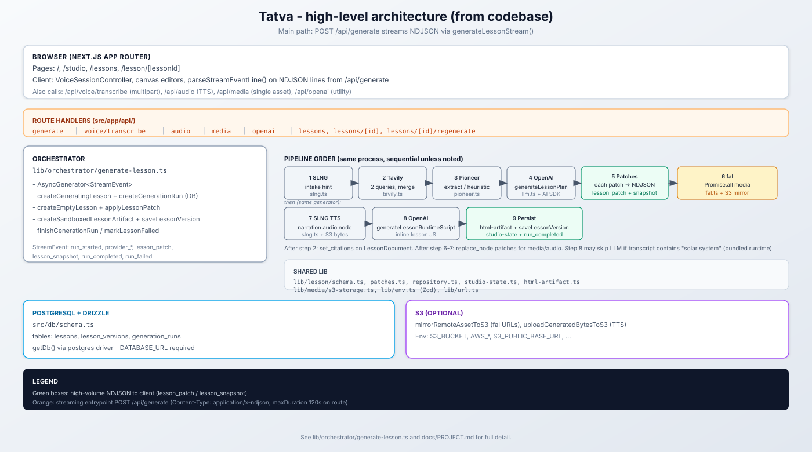

# Tatva — Voice-First Knowledge Studio
### Built for Ignite With Bangalore · October 17, 2026



**Tatva** transforms spoken conversations—lectures, speeches, debates, and collaborative roundtables—into permanent, interactive structured intelligence. 

Instead of an unstructured transcript or a generic chat summary, Tatva listens in real time, and the moment you press **End Session**, it automatically synthesizes a full **Knowledge Canvas** (learning objectives, core concept breakdowns, milestone timelines, interactive verification quizzes, speaking statistics, and AI recommendations) with zero manual prompting.

Builders can then converse directly with **Tatva's Interactive Voice AI Companion**, powered by **SLNG** and declarative **UNMUTE** agents.

---

## ⚡ Key Highlights

- **Live Streaming Speech-to-Text**: Server-side WebSocket relay to **SLNG Deepgram Nova 3 (English)** with live partial and final transcripts.
- **Zero-Prompt Autonomous Synthesis**: Post-session analysis runs automatically using **Groq** (`openai/gpt-oss-120b`) with Server-Sent Events (SSE) progressive card delivery.
- **Interactive Knowledge Canvas**: 7 rich, interactive cards (Summary, Curriculum Objectives, Concept Maps, Breakthrough Timelines, Interactive Knowledge Quizzes with instant answer evaluation, Speaking Telemetry, and Strategic AI Suggestions).
- **Declarative Voice Companion (UNMUTE + SLNG)**: Custom-compiled UNMUTE agent (`companion/agent.yaml`) deployed to the Indian region (`in`) with Cartesia Sonic 3 TTS, Deepgram Nova 3 STT, and GPT-4.1 mini, injected with runtime session context arguments.

---

## 📁 Repository Structure

```text
Ignite/
├── backend/                  # FastAPI Application
│   ├── main.py               # Server entry point & CORS configuration
│   ├── database.py           # aiosqlite SQLite persistence & demo seeding
│   ├── models.py             # Pydantic schemas
│   ├── sessions.py           # Session lifecycle & transcript endpoints
│   ├── stt_relay.py          # WebSocket relay from browser to SLNG Nova 3
│   ├── analysis.py           # Groq LLM progressive SSE card generation
│   ├── companion.py          # Proxies SLNG web-session creation
│   └── requirements.txt      # Python dependencies
│
├── companion/                # UNMUTE Voice Companion Package
│   ├── agent.yaml            # Declarative voice agent definition
│   ├── instructions.md       # Session-aware agent prompt with {{state.*}}
│   ├── targets.yaml          # SLNG deployment configuration (region: in)
│   ├── state.py              # Pydantic typed state model for context injection
│   └── tools/                # Builtin tool definitions (end_call)
│
├── frontend/                 # React 19 + TypeScript + Vite + Tailwind CSS
│   ├── src/
│   │   ├── components/       # NavBar, WaveformVisualizer, LiveTranscript, KnowledgeCard, CompanionPanel
│   │   ├── pages/            # Workspace, StartSession, LiveStudio, Distilling, KnowledgeCanvas
│   │   ├── hooks/            # useAudioCapture, useSLNGTranscript, useCompanionSession
│   │   └── api/              # Typed backend API client
│   └── tailwind.config.js    # Design tokens matching Stitch design audit
│
├── bin/                      # UNMUTE CLI executable (v0.7.4)
├── .env.example              # Environment variables template
└── README.md
```

---

## 🚀 Quick Start Guide

### 1. Environment Setup

Copy `.env.example` to `.env` in the root workspace:

```bash
cp .env.example .env
```

Fill in your API keys in `.env`:

```ini
SLNG_API_KEY=your_slng_api_key_here
GROQ_API_KEY=your_groq_api_key_here
GROQ_MODEL=openai/gpt-oss-120b
```

### 2. Start the FastAPI Backend

```bash
cd backend
python -m uvicorn main:app --reload --port 8000
```

*The database automatically initializes and pre-seeds a comprehensive demonstration session (`demo-voice-ai-lesson`) so you can explore all features instantly.*

### 3. Start the Frontend

```bash
cd frontend
npm install
npm run dev
```

Open `http://localhost:5173` in your browser.

---

## 🎙️ UNMUTE Agent Compilation & Deployment

The companion package in `companion/` is fully verified with the UNMUTE compiler:

```bash
# Validate agent syntax, state schema, and SLNG targets
.\bin\unmute.exe validate companion

# Compile to production SLNG deployment payload
.\bin\unmute.exe compile companion

# Deploy to SLNG hosted cloud target
.\bin\unmute.exe deploy companion --target slng
```

Once deployed, copy the generated Agent ID into your `.env` as `SLNG_AGENT_ID`.

---

## 🏆 Hackathon Demo Script (3-Minute Walkthrough)

1. **Workspace Screen (`/`)**:
   - Showcase the pre-seeded demo lesson on *Voice AI Architecture & Latency Optimization*.
   - Point out the 4 session operating modes: **Lesson**, **Speech**, **Debate**, and **Discussion**.

2. **Start a Session (`/start`)**:
   - Choose **Lesson & Lecture** mode.
   - Enter a title or click a topic suggestion (e.g., *"Distributed Consensus in Modern Systems"*).
   - Click **Launch Voice Studio**.

3. **Live Voice Studio (`/live/:id`)**:
   - Click **Start Mic Stream** (streams audio to SLNG Nova 3 STT) or click **Simulate Lecture Speech** for quick offline demonstration.
   - Watch the live waveform animate and real-time transcripts scroll with speaker labeling.
   - Click **End Session & Distill**.

4. **Distilling Insights (`/distilling/:id`)**:
   - Highlight the **progressive SSE card stream**: without any manual prompt, cards stream sequentially directly from Groq LLM (Summary → Objectives → Concepts → Moments → Quiz → Telemetry → Suggestions).

5. **Interactive Knowledge Canvas (`/canvas/:id`)**:
   - Explore the 7 synthesized cards.
   - Answer quiz questions interactively with immediate feedback and explanation reveals.
   - Click **Export Markdown** to download the complete session report.
   - Click **Talk to Tatva** to open the voice companion panel.


## Prototype limitations

Session data is stored locally in SQLite; speech and selected session text are processed by configured cloud providers. This prototype has no production authentication. Speaking statistics are estimates, and the four session modes share analysis schemas. The companion uses bounded session context, not full-document retrieval. Live voice requires SLNG credentials; the companion additionally requires a deployed agent ID.

Install UNMUTE and the SLNG voiceai CLI separately to deploy the companion. On Windows, use WSL for the Linux voiceai CLI. Executables, credentials, generated builds, recordings, and local session databases are excluded from this repository.

